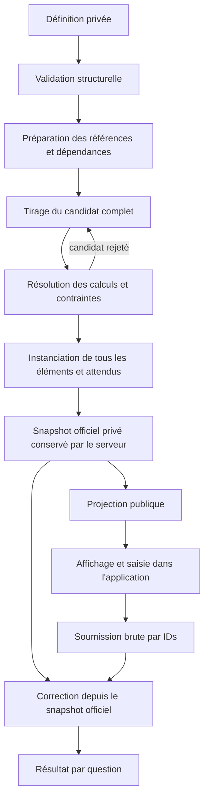

# Architecture

## Périmètre et responsabilités

Le moteur est une bibliothèque de fonctions synchrones et de contrats JSON.
Il valide des définitions, résout leurs paramètres, prépare les éléments et les
attendus, projette une vue publique et corrige une réponse par question. Toutes
les applications visées partagent ces mêmes règles.

CortexJS 0.151.0 assure le parsing LaTeX, la substitution, les calculs et les
opérations symboliques utilisées dans les profils admis. Ses objets boxed restent
internes. Les résultats publics sont des données détachées, avec source et
MathJSON quand le contrat le prévoit. Aucun CAS parallèle ni deuxième parseur LaTeX.

| Frontière                        | Responsabilité                                                                             |
| -------------------------------- | ------------------------------------------------------------------------------------------ |
| Cœur portable, entrée du package | Définition, génération, instanciation, projection et correction                            |
| Sous-chemin `node-host` et CLI   | Processus neuf, protocole privé, file, quotas et interruption OS                           |
| Sous-chemin `remote-host`        | Client serveur HTTPS vers `POST /run`, token privé et empreinte d’archive épinglée          |
| Sous-chemin `legacy`             | Conversion explicite de sources historiques avec recette revue et rapport                  |
| Backend applicatif               | Droits, définition publiée, seed/ID officiels, stockage, tentatives, points et progression |
| Interface élève/Admin/duels      | Édition, rendu, MathLive, interactions et feedback autorisé                                |

FastAPI et MathLive sont utilisés dans les exemples locaux. Aucun service de
production NovLearn, Admin ou Colyseus n’est livré ici.

## Contrats et identités

Les [types principaux](../src/contracts/types.ts) et les
[éléments de présentation](../src/contracts/elements.ts) font référence.
La validation runtime refuse les champs inconnus, versions non admises et données
non inertes : getters, classes, cycles, non-finis, tableaux creux et clés dangereuses.
`extensions` conserve du JSON privé non interprété.

| Contrat                                   | Contenu et rôle                                                                                                                          |
| ----------------------------------------- | ---------------------------------------------------------------------------------------------------------------------------------------- |
| `ExerciseDefinition`                      | `schemaVersion:5`, `kind:'composed'`, `id/revision/title`, catalogue privé facultatif, génération, inconnues libres et éléments ordonnés |
| `GenerationDefinition`                    | Même contrat autonome et imbriqué : déclarations, contraintes et budgets obligatoires                                                    |
| `VariableDefinition`                      | Scalaire entier/décimal/choix, tuple ou formule `computed`                                                                               |
| `FreeVariableDefinition`                  | Inconnue déclarée `real` ou `integer`, qui reste symbolique                                                                              |
| `ExerciseElement`                         | Union discriminée de contenus et questions ; `id` stable et `sectionId` facultatif                                                       |
| `QuestionDefinition` / `AnswerDefinition` | Branches `question` et `mcq` ; attendu et politique privés attachés à l’ID de question                                                   |
| `GeneratedValue`                          | Entier/choix avec `value`, décimal avec coefficient/précision, calculé avec numérateur/dénominateur exacts                               |
| `ExerciseInstance`                        | Snapshot privé : définition détachée, version moteur, génération, titre et éléments instanciés                                           |
| `ExpectedAnswer`                          | Valeur/trace mathématique, expression préparée, variantes textuelles ou sélection d’IDs                                                  |
| `PublicInstance`                          | Schéma, ID opaque, titre et éléments affichables sélectionnés ; aucun attendu ni seed                                                    |
| `AnswerSubmission`                        | Schéma, `instanceId/questionId`, source LaTeX/texte brute ou IDs QCM                                                                     |
| `CorrectionResult`                        | État, valeur, comparaison, forme, domaine, preuve et code par question, sans données privées                                             |

`generation.definitions` contient les paramètres à résoudre ; `variables`
contient les inconnues mathématiques. Leurs noms sont disjoints. Une composante
de tuple est adressée par son nom plat ; le tuple n’est pas un vecteur.
`generation.values` est l’unique table de valeurs. `groups` relie les composantes
ordonnées à leur groupe ; `computed` relie les calculs à leurs dépendances.

Un exercice à une question utilise le même modèle qu’un problème long. La liste
reste plate. Les sections sont des éléments explicites, référencés par ID,
indépendamment de leur position. Chaque soumission est corrigée séparément ;
l’application conserve les questions non répondues et les tentatives partielles.
Les points descriptifs d’une question ne calculent aucun score applicatif.

## Pipeline complet

Les reprises de tirage sont limitées par les budgets. Un diagnostic terminal à
n’importe quelle étape empêche le retour d’une instance partielle.

1. `validateDefinition` contrôle la structure et les références structurelles.
   Cette validation seule ne prouve pas que toutes les formules sont calculables.
2. `generateVariables` prépare les formules via CortexJS, détecte les références
   inconnues et cycles, puis établit un tri topologique stable **avant le RNG**.
3. La boucle tire les déclarations aléatoires dans leur ordre, résout chaque
   `computed` une fois par candidat, puis vérifie restrictions et comparaisons.
   Une condition fausse retire tout le candidat. Singularité, erreur ou preuve
   inconnue terminent la génération, même après une condition déjà fausse.
4. `instantiateExercise` appelle cette résolution une seule fois, puis traite
   textes, formules, options et attendus de toutes les questions. Les textes
   utilisent `@nom` et `@@` ; la substitution mathématique passe par CortexJS.
5. L’instance finale conserve définition/source, syntaxe raw, substitution,
   affichage dérivé et données privées, dans les limites du JSON agrégé.
6. `projectPublicInstance` sélectionne les champs à chaque niveau imbriqué.
   Les indications et explications privées sont retirées intégralement.
7. `gradeAnswer` valide la soumission, associe ses IDs au snapshot officiel,
   contrôle format/admissibilité/domaine et témoins de forme, puis compare avec
   une méthode admise. Valeur et forme déterminent séparément le résultat.

L’application effectue le lookup officiel, les droits et les contrôles de
manche/expiration avant et après un appel asynchrone à l’hôte. Le banc
[M11](demo.md) illustre cette intégration ; elle n’est pas ajoutée au cœur.

## Frontière mathématique

Le parsing public lit une syntaxe ; il ne démontre pas une valeur ou un domaine.
La source originale reste indispensable, car même le raw CortexJS peut effacer
certains témoins. Les gardes lexicales détectent notamment placeholders et
scripts vides sans transformer l’algèbre.

Les noms suivent `[a-z][A-Za-z0-9]{0,31}`, hors réservés. Dans une formule,
`\mathrm{delta}` référence le nom déclaré, tandis que `ab` conserve le produit
implicite. Les dictionnaires CortexJS sont locaux à chaque appel.

Les opérations d’exécution inspectent descendants et restrictions avant
réduction. Cela empêche d’admettre `0*(1/0)` comme zéro ou de perdre le trou de
`x/x`. Les coefficients et produits croisés algébriques sont calculés par CortexJS.
`isIdenticallyEqual()` seul et quelques évaluations numériques ne constituent
pas une preuve universelle.

La présentation `mode:'display'` substitue sans évaluation ni preuve de domaine ;
le public porte `formulaDomain:'unverified'`. Les nombres de rendu utilisent
le profil rationnel exact. Un graphe, tableau ou système présenté ne résout
pas les mathématiques qu’il décrit. Les profils, bornes et contre-exemples sont
centralisés dans [features](features.md) et détaillés dans les ADR.

## Sécurité et isolation

La projection et le correcteur attendent un snapshot **officiel de confiance**.
Le garde `schemaVersion/engineVersion/generation.version` refuse les versions
inconnues ; il n’authentifie pas le snapshot et ne valide pas intégralement un
objet externe. Le navigateur ne choisit jamais attendu, politique, seed ou verdict.

Le cœur est synchrone. Les limites structurelles et contextes locaux ne suffisent
pas à interrompre un calcul bloquant. L’hôte optionnel crée un processus neuf,
contrôle file/entrée/sortie et dispose d’un watchdog externe. Linux exige un
cgroup v2 déjà borné, sans swap, avec limite de processus ; son quota est partagé.
Windows utilise un Job Object. Le lanceur était refusé dans le contexte M9/M12 ;
les tests natifs Windows ont passé pendant cet audit documentaire, sans changement
de politique OS par cette mission. Sans hôte admissible, le résultat est `unavailable`.
[ADR 014](adr/014-isolated-node-host.md) et
[ADR 015](adr/015-private-python-transport.md) distinguent les garanties observées
et l’absence de SLO strict de nettoyage sous pression.

Le canal privé expose les sept opérations du cœur et l’adaptation historique.
Il ne doit pas être publié comme API navigateur. Authentification, stockage
fiable, sandbox de déploiement et protection du rendu restent applicatifs.

## Modules et versions

| Modules réels                                            | Responsabilité                                                        |
| -------------------------------------------------------- | --------------------------------------------------------------------- |
| `src/contracts/`                                         | Types, noms, copie JSON, validation et garde de versions              |
| `src/generation/variables.ts`                            | Options, préparation des formules, dépendances et résolution calculée |
| `src/generation/candidates.ts`, `scalar.ts`, `random.ts` | Boucle atomique, domaines, budgets, tirages et PRNG local             |
| `src/math/input.ts`, `substitution.ts`, `display.ts`     | Lecture raw, admission, substitution et présentation                  |
| `src/math/numeric.ts`, `comparison.ts`                   | Preuves numériques exactes, encadrements et tolérances                |
| `src/math/algebra.ts`, `collections.ts`, `log-affine.ts` | Profils univariés, domaines, solutions et collections                 |
| `src/math/forms.ts`, `form-references.ts`                | Témoins de forme originaux et références officielles                  |
| `src/display-elements.ts`, `math/display-data-checks.ts` | Sélection des champs et cohérence des données prescrites              |
| `src/instantiation.ts`, `grading.ts`, `index.ts`         | Orchestration, projection, correction et exports portables            |
| `src/node-host/`, `runtime/`                             | Hôte/CLI et lanceurs fixes OS séparés                                 |
| `src/adapters/legacy/`                                   | Adaptation revue, conservation et rapport de provenance               |

Le schéma 5 identifie la structure, la révision identifie la définition pédagogique,
`mulberry32-rejection-v1` identifie le tirage, et l’artefact exact identifie le moteur
avec CortexJS. La seed obligatoire est un uint32 ou sa chaîne décimale canonique.
Il n’existe pas de champ `instantiationVersion` concurrent. Même définition,
ordre, budgets, seed, ID et artefact donnent le même snapshot JSON.

Les APIs expérimentales V1–V4 sont refusées. Pour un rejeu entre builds privés
0.2.1, conserver archive et lock par empreinte, puis sélectionner l’artefact
côté serveur. Voir [release](release.md), [usage](usage.md) et [ADR 008](adr/008-canonical-consolidation.md).
