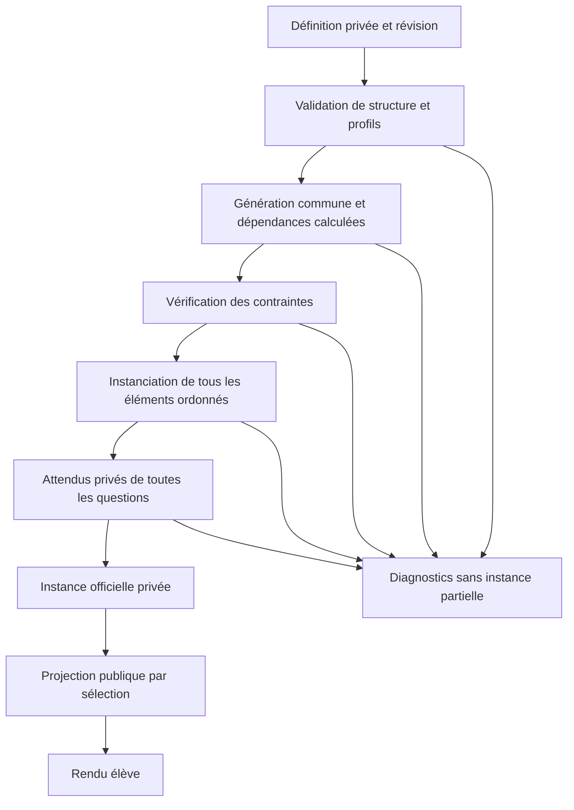
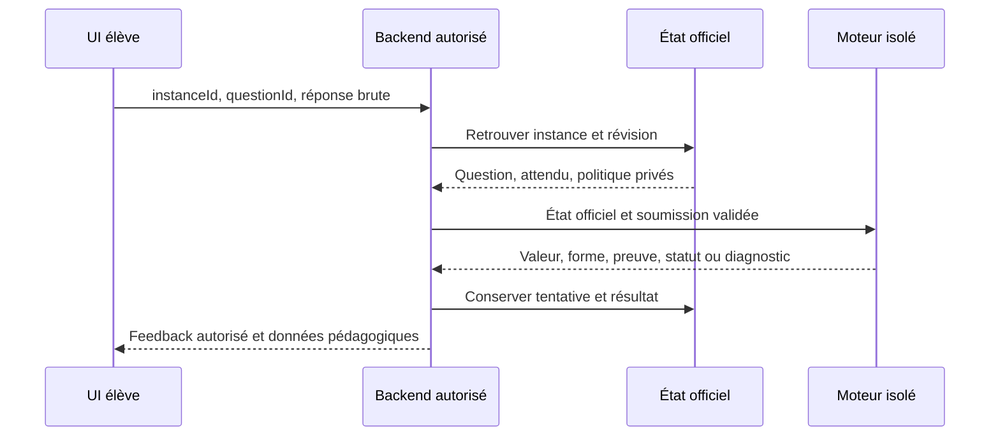

# Parcours d'un exercice

Référence actualisée le 11 octobre 2026 après consolidation canonique. Les étapes applicatives suivantes sont des exigences de parcours, pas des services existants dans ce dépôt. Voir [spécification](functional-specification.md), [architecture](architecture.md) et [preuves de couverture](feature-coverage.md).

## Création et publication dans Admin

Le frontend Admin conserve l'état temporaire des formulaires, y compris les saisies incomplètes. Le backend Admin authentifie, contrôle les droits, valide et persiste. Le moteur reçoit des données JSON, sans connexion DB ni connaissance du compte auteur. La prévisualisation privée nécessite une autorisation d'auteur ; elle n'est pas la projection élève.

| Étape                | Admin / backend                                                                    | Moteur                                                                          | Données et validations                                                       | Échecs visibles                                                                        |
| -------------------- | ---------------------------------------------------------------------------------- | ------------------------------------------------------------------------------- | ---------------------------------------------------------------------------- | -------------------------------------------------------------------------------------- |
| 1. Créer             | Nouveau brouillon, ID fourni par application                                       | Aucun état persistant                                                           | ID/document temporaire ; aucun ID déduit de seed                             | Droits, conflit d'ID                                                                   |
| 2. Métadonnées       | Titre, chapitre/difficulté/compétences, flags utiles ; références validées backend | Structure/version/tailles des champs retenus                                    | Métadonnées ; taxonomie externe, aliases legacy explicites                   | Taxonomie inconnue, type/longueur, collision de flags                                  |
| 3. Variables         | Choisir mécanisme et noms                                                          | Vérifier déclarations, collisions, capacités                                    | Domaines, scalaires/composantes/computed/variables libres distincts          | Type absent, nom réservé, doublon                                                      |
| 4. Contraintes       | Configurer exclusions et relations déclaratives                                    | Domaines locaux, profils/références ; calcul de faisabilité seulement borné     | Bornes, listes, tuple, prédicats ; jamais JS                                 | Domaine vide prouvé, référence/cycle, profil non admis                                 |
| 5. Éléments          | Ajouter, éditer, supprimer, réordonner et sectionner                               | Valider union discriminée, ID et champs mathématiques                           | Liste ordonnée ; contenu adapté au consommateur                              | Type inconnu/hors support, ID dupliqué, source invalide                                |
| 6. Questions         | Créer IDs stables, énoncé et format                                                | Association question/format                                                     | Question = élément corrigible ; conservation des IDs au déplacement          | Question sans format, ID réutilisé, suppression liée à anciennes versions              |
| 7. Attendus          | Saisir expression ou IDs QCM corrects                                              | Valider/calculer sur profil admis                                               | Attendu privé par question ; contexte des variables                          | Attendu symbolique, domaine invalide, option inexistante                               |
| 8. Politique         | Choisir règle mathématique et paramètres pédagogiques                              | Vérifier compatibilité forme/domaine/tolérance/famille                          | Politique privée par question ; points descriptifs                           | Forme non supportée, tolérance invalide, politique contradictoire                      |
| 9. Prévisualiser     | Fournir seed/ID de travail, afficher vue auteur et projection élève                | Instancier toute la définition, calculer attendus et diagnostics                | Instance privée de preview, jamais tentative officielle                      | Génération, domaine, budget ou élément non calculable                                  |
| 10. Plusieurs seeds  | Lancer une liste bornée, agréger les diagnostics                                   | Même pipeline pour chaque seed ; pas de moteur de test distinct                 | Révision/versions/seeds ; coûts plafonnés par l'hôte                         | Candidats rejetés, ambiguïté QCM, ressources ; aucune preuve exhaustive                |
| 11. Diagnostics      | Relier stage/path à un champ et expliquer                                          | Codes/chemins/motifs, données sensibles privées                                 | Validation, calcul et limites distingués                                     | Erreur technique séparée de défaut d'auteur                                            |
| 12. Corriger         | Modifier le brouillon et refaire les contrôles                                     | Revalider ; aucun patch implicite                                               | Nouvelle définition de travail ; sources originales conservées               | Erreurs persistantes, nouvelle incompatibilité                                         |
| 13. Sauver brouillon | Persister sous droits et contrôle de concurrence                                   | Validation structurelle utilisable ; brouillon incomplet reste non instanciable | État d'édition distinct d'une définition publiée admise                      | Conflit, stockage, droits ; le validateur actuel n'accepte pas un brouillon arbitraire |
| 14. Publier          | Créer révision immuable, contrôler références et capacités des consommateurs       | Validation complète du périmètre supporté et instanciation de contrôle          | Définition privée/version/rapport ; aucun écrasement des anciennes instances | Défaut bloquant, profil non supporté, conflit de révision                              |

Un brouillon invalide peut être sauvegardé par l'application dans un format d'édition séparé ; cela n'autorise pas sa publication. Le stockage/publication ne devient pas une fonction du moteur. Creator actuel utilise une même action sauvegarder/publier : le workflow ci-dessus reste à développer dans Admin.

Les séries de seeds détectent des défauts (par exemple les collisions de distracteurs) sans certifier toutes les générations possibles. Les contraintes et preuves mathématiques nécessaires restent vérifiées à **chaque** instance officielle. Les diagnostics internes d'auteur et attendus ne sont jamais transmis automatiquement à l'élève.

## Instanciation et séparation des vues

1. Le backend sélectionne une définition publiée admissible et sa révision exacte ; il fournit seed et ID opaque indépendants. Les valeurs et politiques du client ne sont pas une entrée officielle.
2. Le moteur valide et détache les données. Profils, références/cycles et domaines statiques sont contrôlés avant tirage dans le profil canonique admis. La définition/source originale est conservée, sans mutation.
3. Générer une seule fois les scalaires/groupes puis computed dans l'ordre topologique ; vérifier domaines et prédicats selon les budgets/version. Refaire un candidat uniquement selon stratégie déclarée. Indétermination ou épuisement donne un échec distinct.
4. Parcourir tous les éléments en conservant IDs/ordre. Texte et mathématiques ont des traitements distincts ; substitutions mathématiques via CortexJS. Les calculs de figures, lorsqu'admis, produisent des données, pas des pixels.
5. Préparer chaque attendu et sa politique privée. Contrôler admissibilité/domaine avant réduction ; aucun attendu approximatif annoncé exact. Les IDs d'options persistent même si un ordre d'affichage change.
6. Construire et vérifier l'instance complète : définition/révision, versions, valeurs typées, sources nécessaires, affichage et attendus. Aucun échec ne renvoie une instance partiellement valide.
7. Le backend conserve l'état officiel. `projectPublicInstance` sélectionne des champs affichables et détachés ; aucun spread de définition, `correct`, solution, seed, extensions, politique privée ou trace de génération. Un calcul élève possible à partir de l'énoncé ne constitue pas une fuite de champ privé.

État réel : un seul pipeline sous schemaVersion 5, package privé 0.1.0. Scalaires integer/decimal/choice, tuples, computed et contraintes exactes bornées alimentent la liste texte/section/expression/question/QCM. Attendus par ID, projection et rejeu sont testés. Figures avancées, correction et intégrations applicatives restent différées. La projection accepte un snapshot **officiel de confiance**, sans authentifier des objets privés fournis par le client. Voir [architecture canonique](architecture.md) et [limites](feature-coverage.md).

## Parcours élève et tentatives

| Étape                             | Responsable et données                                                         | Garantie / limite                                                                   |
| --------------------------------- | ------------------------------------------------------------------------------ | ----------------------------------------------------------------------------------- |
| 1. Ouvrir                         | Frontend demande un exercice/une tentative au backend                          | Auth et choix pédagogique externes                                                  |
| 2. Résoudre la définition publiée | Backend retrouve révision privée et capacités                                  | Le navigateur ne reçoit pas directement le document complet contenant les solutions |
| 3. Générer / reprendre            | Backend construit une instance officielle ou retrouve la précédente            | Même tentative → mêmes valeurs ; rechargement ne régénère pas silencieusement       |
| 4. Afficher                       | UI consomme la projection publique                                             | Ordre et IDs intacts ; renderer compatible, texte/LaTeX et figures                  |
| 5. Répondre                       | UI conserve brouillons locaux par question                                     | Source brute ou IDs QCM, aucune valeur de vérité officielle                         |
| 6. Soumettre                      | API transmet instanceId/questionId/réponse brute                               | Auth, appartenance, existence, quotas et anti-rejeu vérifiés par backend            |
| 7. Corriger                       | Backend retrouve état officiel puis appelle futur correcteur                   | Un résultat par question soumise, pas d'agrégat booléen universel                   |
| 8. Appliquer pédagogie            | Backend calcule points/progression selon politique                             | Indéterminé/erreur ne doivent pas être transformés en faute mathématique            |
| 9. Feedback                       | Backend sélectionne feedback autorisé ; UI affiche                             | Indice/solution selon mode et moment ; le moteur ne publie pas seul ses attendus    |
| 10. Persister                     | Backend conserve tentative, réponses/résultats/révision/instance selon besoins | Rétention, données personnelles et reprise relèvent de l'application                |

### Cas particuliers

- **Tentative partielle** : corriger seulement les questions soumises ; les autres restent non répondues. Une omission n'est ni une réponse vide ni une preuve de faute. Soumission vide explicite peut être conservée par validation structurelle puis diagnostiquée par parsing.
- **Plusieurs réponses** : transport peut grouper des soumissions individuelles ; doublon de question dans une même commande traité explicitement par le backend, sans dernière valeur gagnante implicite. Ce dépôt ne requiert pas une API batch publique supplémentaire.
- **Réponse multiple QCM** : un ensemble d'IDs pour une question, sans doublon, vérifié contre les options officielles ; cardinal/format adaptés au mode.
- **Réessai** : nouvelles soumissions identifiées par l'application et politique d'essais serveur ; le moteur reste sans historique mutable. Crédits partiels et coût d'un indice ne sont pas décidés ici.
- **Interruption / reprise** : état de tentative et instance conservés côté backend ; reprendre la révision/valeurs figées. Abandon, expiration et clôture sont applicatifs. Une instance non retrouvable produit une erreur d'association, pas une correction de valeurs régénérées arbitrairement.
- **Version de moteur changée** : réutiliser snapshot et correcteur compatible, ou artefact ancien pour rejeu ; ne pas promettre une correction équivalente après upgrade sans tests. Un protocole de migration d'instances requiert un lot séparé.
- **Feedback** : avant résolution, uniquement champs publics et aides autorisées ; après soumission, verdict/motif pédagogique sélectionnés ; solution détaillée après clôture ou autorisation d'auteur. Mode examen/duel peut retenir toute solution jusqu'à fin. Choix précis de visibilité reste au produit, hors correction mathématique.

## Parcours de correction officielle

Ordre détaillé : validation structurelle de soumission ; association à l'instance officielle ; parsing sous profil officiel ; contrôle d'admissibilité/symboles ; domaine et témoins de forme avant réduction ; méthode exacte bornée de comparaison ; application de la politique de forme/tolérance ; résultat structuré. Une méthode insuffisante donne indéterminé. Différence exacte donne incorrect. Un attendu officiel invalide donne défaut d'exercice/erreur de correction, jamais faute élève. Timeout/crash donnent erreur technique.

La saisie/politique ne doivent pas être reconstruites depuis l'affichage, ni validées par un booléen client. Une prévalidation navigateur peut améliorer l'UX, sans remplacer les contrôles serveur. La politique de mêmes domaines par défaut est celle confirmée dans la [spécification](functional-specification.md) ; ses méthodes devront être prouvées par famille. Ce parcours est absent aujourd'hui, prévu aux Lots 6/7/8 puis démonstration 10.

## Duels

Colyseus choisit une définition publiée et une instance commune pour les joueurs ; même révision, mêmes valeurs, éléments et options. L'ordre d'options conservé suffit d'abord ; tout mélange ultérieur doit être reproductible et stocké/versionné. Colyseus garde les attendus privés et diffuse seulement la projection publique. Il réutilise le même package/correcteur, dans un contexte de calcul isolé et terminable ; aucun calcul coûteux officiel dans son event loop.

Chaque soumission référence l'instance **courante** et la question. Colyseus vérifie joueur, tour, délai, cardinal/options et rejet des anciennes instances, puis retrouve attendu/politique et appelle le correcteur. Classement, points, gagnant, abandon, skip, matchmaking et horloge restent au serveur de duels. L'horodatage client n'est pas l'autorité sur le délai.

Écart observé : `DuelRoom.ts` reçoit `isCorrect`, l'enregistre et décide à partir de ce booléen ; il diffuse `currentExercise` complet avec variables. Ces comportements historiques ne satisfont pas la cible. Aucun changement n'est effectué dans le dépôt voisin ; adoption officielle conditionnée au correcteur/isolation, projection sûre et tests de falsification/rejeu du Lot 10.
